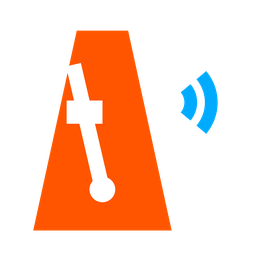
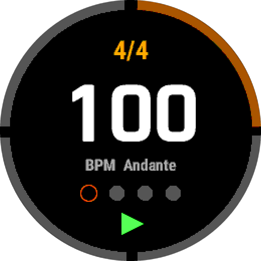
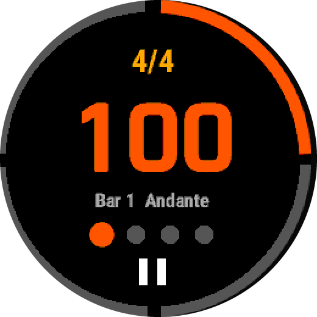
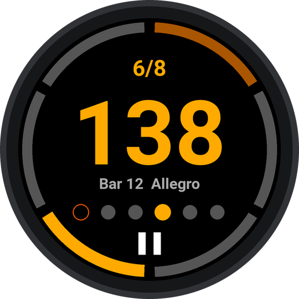
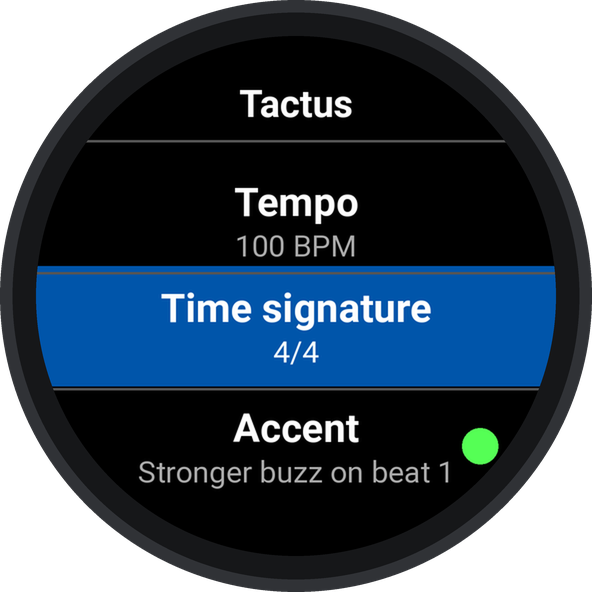
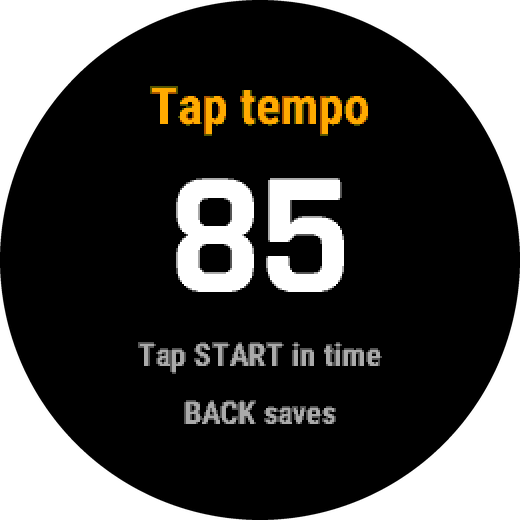
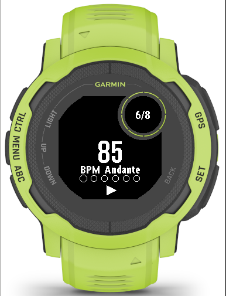

<p align="center"></p>

# Tactus

**A metronome you feel instead of hear.** Tactus buzzes the beat on your wrist so you can keep time while you play: no click track in your ears, nothing for the audience to hear.

Made for the Garmin fenix 7, and it also runs on most Connect IQ watches from the fenix 5 onwards. Colour watches get a colour display. Black-and-white watches like the Instinct 2 get a high-contrast black-and-white display.

*Tactus* is the Renaissance word for the musical beat, the steady pulse a choir conductor marked with his hand. It also sounds like *tactile*, which is how the app works.

<p align="center">
  
  
  
</p>

## Features

- **Vibrating pulse** on every beat, with a stronger, longer buzz on beat 1
- **Secondary accents** in compound and odd time: 6/8, 9/8 and 12/8 every dotted quarter, 7/8 counted 2+2+3, 5/4 counted 3+2
- **Time signatures:** 1/4, 2/4, 3/4, 4/4, 5/4, 6/8, 7/8, 9/8, 12/8
- **Tempo 30–250 BPM**, with the Italian tempo marking shown (Largo, Andante, Allegro…)
- **Tap tempo:** tap START in time with the music and Tactus picks up the tempo
- **Vibrate, beep, or both.** Beeps need a watch with a speaker or beeper, such as the fenix.
- **Three vibration strengths** (light, medium, strong)
- **Colour or black-and-white display.** *Auto* picks the right one for your watch, and you can also choose it yourself.
- **Beat ring** around the edge of round screens, plus a dot for each beat and a bar counter
- **Timing that doesn't drift.** Each beat is scheduled against an absolute clock, so the tempo stays accurate through a whole set.
- Remembers your settings
- English and Swedish (Svenska)

## Controls

| Button (fenix, Forerunner, Instinct) | Touch (Venu, vivoactive, fenix 7 touchscreen) | Action |
|---|---|---|
| **START** | Tap the screen (outside the number) | Start / stop |
| **UP** | Swipe down | +1 BPM |
| **DOWN** | Swipe up | −1 BPM |
| — | Tap the tempo number | Pick a tempo from a list |
| **Hold UP** (Menu) | Menu gesture / hold button | Settings |
| **BACK** | Back button / swipe right | Stop. When stopped, exit. |

**Settings menu:** Tempo · Tap tempo · Time signature · Accent · Pulse (vibrate / beep / both) · Vibration strength · Display (auto / colour / black and white)

<p align="center">
  
  
</p>

<p align="center">
  <br>
  <em>On the Instinct 2 the time signature sits in the round sub-screen.</em>
</p>

## Supported watches

Connect IQ 3.1 or newer is required. The manifest includes:

- **fenix** 5 / 5S / 5X, 5 Plus series, 6 series, **7 / 7S / 7X** and 7 Pro series, 8 series, fenix E
- **epix** (Gen 2) and epix Pro, **Enduro** and Enduro 3
- **Forerunner** 165, 245, 255, 265, 745, 945, 945 LTE, 955, 965
- **Venu**, Venu 2 / 2S / 2 Plus, Venu 3 / 3S
- **vivoactive** 3, 4 / 4S, 5
- **Instinct 2** / 2S / 2X, Instinct Crossover (black and white)

Other Connect IQ 3.1+ watches will most likely work too. Add them in VS Code with **Monkey C: Edit Products**.

## Installation

**fēnix 7 or Instinct 2:** download `Tactus-fenix7.prg` or `Tactus-instinct2.prg` from the [latest release](https://github.com/jonsolberg/tactus/releases/latest). Connect the watch with USB and copy the file to its `GARMIN/APPS` folder. That's it.

**Other watches:** build it yourself. See **[docs/INSTALL.md](docs/INSTALL.md)** for full step-by-step instructions. In short:

1. Install VS Code, the Garmin **Monkey C** extension and the **Connect IQ SDK** (via the SDK Manager), and download the device files for your watch.
2. Create a developer key: **Monkey C: Generate a Developer Key**.
3. Build: **Monkey C: Build for Device** → pick your watch (e.g. `fenix7`). This produces `Tactus.prg`.
4. Connect the watch with USB and copy `Tactus.prg` to the watch's **`GARMIN/APPS`** folder.
5. Unplug the watch. Press START on the watch face and pick Tactus. If it isn't listed, use *Add* at the bottom of the list.

## Tips for practising

- **Strong** vibration is easiest to feel while playing guitar or drums. **Light** is enough for piano or singing.
- Wear the watch snugly on the inside of the wrist if you have trouble feeling the beat at fast tempos.
- At very fast tempos (above ~200 BPM) the pulses get short. Try setting half the tempo (in 2/4 instead of 4/4, for example).
- If you see *Vibration is off*, turn vibration back on in the watch's own settings (under *System → Sounds & Alerts* on the fenix 7).
- Tactus is a watch app, so it keeps running while it's on screen. Press BACK to stop and leave.

## Building and publishing

On Windows, the quickest route is the build script. It finds the SDK you picked in the SDK Manager:

```powershell
Set-ExecutionPolicy -Scope Process Bypass
.\build.ps1 -Key C:\path\to\developer_key.der           # .prg for fenix 7 + .iq for the store
.\build.ps1 -Key ...\developer_key.der -Device instinct2 -PrgOnly
```

## Building from the command line (any OS)

```sh
monkeyc -d fenix7 -f monkey.jungle -o bin/Tactus.prg -y /path/to/developer_key.der
# run in the simulator
connectiq &
monkeydo bin/Tactus.prg fenix7
```

To export a package for the Connect IQ Store (all devices): **Monkey C: Export Project** in VS Code, or
`monkeyc -e -f monkey.jungle -o bin/Tactus.iq -y developer_key.der -r`.

## Project layout

```
manifest.xml              app id, supported watches, languages
monkey.jungle             build config; maps B&W watches to resources-mono
source/
  TactusApp.mc            app entry point
  MetronomeEngine.mc      drift-free beat timing
  Pulse.mc                vibration / tone output
  MetronomeView.mc        main screen (colour + B&W)
  MetronomeDelegate.mc    buttons and touch
  SettingsMenu.mc         settings menu and choice lists
  TempoPicker.mc          number picker for tempo
  TapTempo.mc             tap-tempo screen
  Prefs.mc                saved settings, time signatures, accents
  Theme.mc                colour and black-and-white palettes
resources/                English strings, colour icon
resources-swe/            Swedish strings
resources-mono/           black-and-white theme default and icon
build.ps1                 Windows build script (.prg + store .iq)
docs/                     install guide, store guide, screenshots
```

## Support

Tactus is free, open source and has no ads. If you enjoy it, you can
[buy me a beer on Ko-fi](https://ko-fi.com/jonsolberg) 🍺

[](https://ko-fi.com/jonsolberg)

## License

Copyright © 2026 Jon Solberg

Tactus is free software: you can redistribute it and/or modify it under the terms of the **GNU General Public License v3.0** or (at your option) any later version. See [LICENSE](LICENSE).
